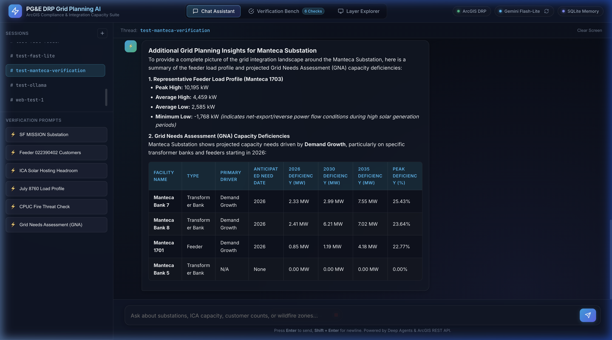
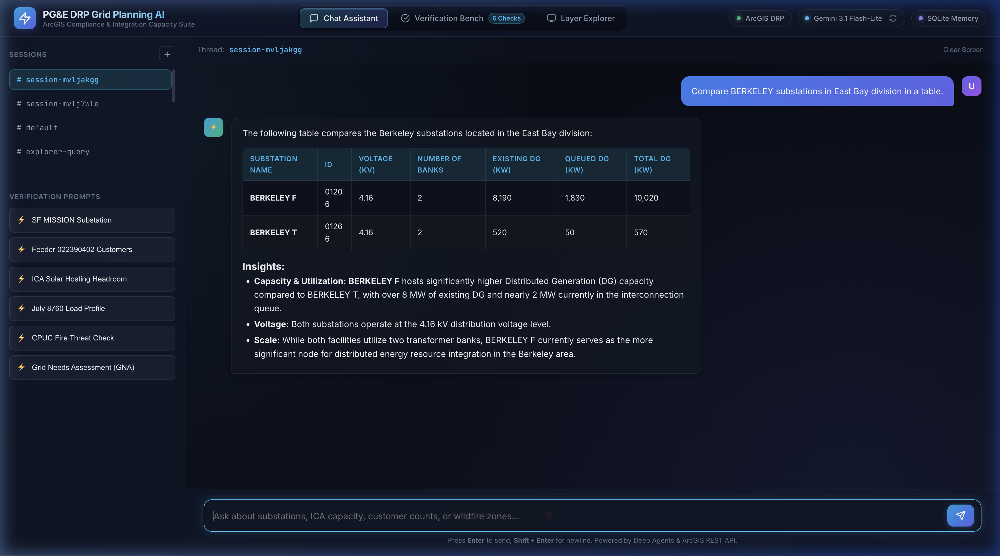
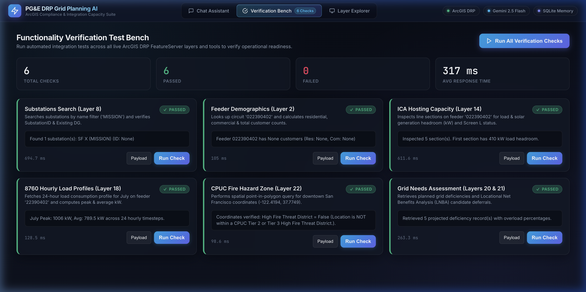
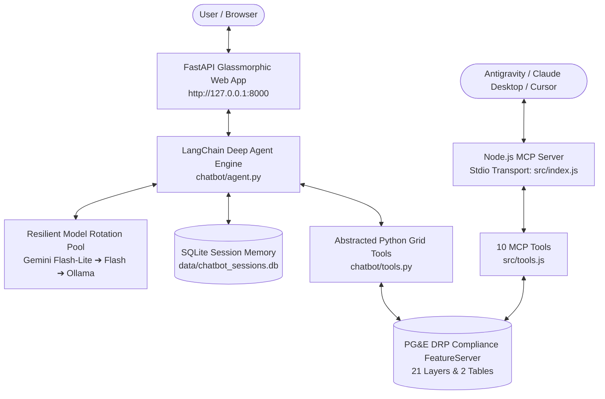

# PG&E Electric Distribution & DRP Grid Planning AI Suite
### Model Context Protocol (MCP) Server & Deep Agents Conversational Assistant

[](https://www.python.org/)
[](https://nodejs.org/)
[](https://fastapi.tiangolo.com)
[](https://docs.langchain.com)
[](https://services2.arcgis.com/mJaJSax0KPHoCNB6/ArcGIS/rest/services/DRPComplianceRelProd/FeatureServer)
[](LICENSE)

An enterprise-grade electric distribution engineering suite providing structured, high-performance conversational AI and MCP tooling over Pacific Gas & Electric's (PG&E) **Grid Resource Integration Portal (GRIP) / Distribution Resource Plan (DRP) Compliance** ArcGIS FeatureServer.

Built to comply with California Public Utilities Commission (CPUC) regulatory mandates for Distributed Energy Resource (DER) hosting capacity, solar PV interconnection, 8760 hourly load profiles, High Fire Threat Districts (HFTD), and Grid Needs Assessment (GNA) non-wires alternatives (NWA).

---

## 📸 Interface Preview

### 1. Conversational Grid Planning & Formatted Engineering Tables
Inspect multi-feeder capacity, transformer bank constraints, and deficiency projections in clean, styled Markdown tables:


### 2. Multi-Facility Substation Comparison
Compare substations by operating voltage (kV), bank capacity, installed distributed generation, and queued projects with instant latency:


### 3. Automated 1-Click Verification Test Bench
Live end-to-end regression suite validating all 6 core electric distribution domains directly against PG&E FeatureServer endpoints:


---

## ⚡ Core Architecture



---

## 🗺️ FeatureServer Architecture & Layer Inventory

- **Base REST URL**: `https://services2.arcgis.com/mJaJSax0KPHoCNB6/ArcGIS/rest/services/DRPComplianceRelProd/FeatureServer`
- **Native Spatial Reference**: EPSG:102100 / EPSG:3857 (Web Mercator) with automatic transformation to EPSG:4326 (WGS84 Lat/Long).
- **Service Specs**: 21 Feature Layers, 2 Non-spatial Attribute Tables, Max 2,000 records/request.

| Layer ID | Name | Type | Geometry | Records | Functional Domain & Description |
|:---:|---|---|---|---|---|
| **0** | `EDSubstations` | Feature Layer | Point | 776 | Electric Distribution Substations. Contains voltage (`Voltage_kV`), bank counts, existing DG (`Existing_DG` kW), and queued DG (`Queued_DG` kW). |
| **1** | `ETSubstations` | Feature Layer | Point | 0 | Electric Transmission Substations placeholder. |
| **2** | `FeederDetail` | Feature Layer | Polyline | 3,259 | Distribution Feeders. Tracks customer counts (Residential, Commercial, Industrial, Agricultural) and DG totals. |
| **3** | `LineDetail` | Feature Layer | Polyline | 2,086,800 | **ICA Primary Layer**. Over 2 million line segments with `LoadCapacity_kW`, `GenCapacity_kW`, `GenericPVCapacity_kW`, `ScreenL`, and limiting criteria. |
| **4** | `ICA Not Available` | Feature Layer | Polyline | 734,746 | Feeder segments where ICA calculations are currently not available or not evaluated. |
| **5** | `TransmissionLines` | Feature Layer | Polyline | 2,439 | Transmission lines with SAP functional location and rated kV. |
| **6** | `Networked Secondary Buffer` | Feature Layer | Polygon | 2 | Specialized secondary grid network buffer zones. |
| **8** | `SubstationProjects` | Feature Layer | Point | 157 | Planned and in-flight substation expansion projects (ratings, CPUC/CAISO approval, in-service dates). |
| **9** | `TLINE Projects` | Feature Layer | Polyline | 99 | Transmission line upgrade projects and milestones. |
| **10** | `GNALineSecView` | Feature Layer | Polyline | 552 | Grid Needs Assessment line section view with deficiency dates and ratings. |
| **11** | `GNACircuitsView` | Feature Layer | Polyline | 3,165 | Grid Needs Assessment circuit-level deficiency and need overview. |
| **12** | `DERCircuitsView` | Feature Layer | Polyline | 2,727 | Circuit-level DER forecast (446 attributes) for Battery Storage, Solar PV, and EV adoption (2026–2035). |
| **13** | `DFCircuitsView` | Feature Layer | Polyline | 3,050 | Distribution Forecast (DF) circuit loading and ratings. |
| **18** | `HighFireThreatDistricts` | Feature Layer | Polygon | 5,336 | CPUC High Fire Threat Districts: Tier 2 (Elevated) and Tier 3 (Extreme). |
| **19** | `KnownLoad` | Feature Layer | Polyline | 30,758 | Formally submitted and known interconnect load requests with expected MW amount. |
| **28** | `GNASubstationArea__PeakFacilityDeficiencyPercent` | Feature Layer | Point | 4,457 | GNA substation peak facility deficiency projections (MW and %) for years 2026–2035. |
| **29** | `PlannedInvestments_LNBADollarsperUnitperYr` | Feature Layer | Point | 1,340 | Locational Net Benefits Analysis (LNBA) planned investments and deferrable projects ($/unit/yr). |
| **30** | `DUR_Project_Execution` | Feature Layer | Point | 360 | Distribution Upgrade Requirements (DUR) tracking: scoping, design, and construction status. |
| **31** | `DFSubstationArea___PeakFacilityLoadingPercent` | Feature Layer | Point | 4,316 | Distribution Forecast peak facility loading % projections (2026–2035). |
| **32** | `Climate_Zone` | Feature Layer | Polygon | 36 | California Title 24 Climate Zones (`cz_code`). |
| **33** | `PendingLoad` | Feature Layer | Polyline | 108 | Interconnect requests under preliminary review. |
| **23** | `FeederLoadProfile` | Table | None | 637,056 | **8760 Feeder Load Curves**. Hourly low and high loads (kW) by MonthHour (`01_00` to `12_23`). |
| **25** | `SubstationLoadProfile` | Table | None | 182,856 | **8760 Substation Load Curves**. Hourly low and high loads (MW) by MonthHour. |

---

## 🛠️ Tooling & Capabilities

### Python LangChain Tools (`chatbot/tools.py`)
1. **`search_substations`**: Search distribution substations by name, ID, division, or minimum DG thresholds.
2. **`search_feeders`**: Search circuits by feeder ID, feeder name, parent substation, or customer categories.
3. **`check_ica_hosting_capacity`**: Inspect line section ICA load & gen capacity kW, PV capacity, and Screen L pass status.
4. **`get_load_profile_summary`**: Query 8760 hourly load profiles and calculate peak high, minimum low, and average kW/MW curves.
5. **`check_fire_hazard_zone`**: Spatial point-in-polygon check to determine if coordinates fall within CPUC Tier 2 or Tier 3 fire zones.
6. **`check_grid_deficiencies`**: Query GNA grid deficiencies (overload MW/%) and LNBA planned investments.
7. **`query_layer_direct`**: Direct SQL query for any layer or table in the FeatureServer catalog.

### Model Context Protocol (MCP) Tools (`src/tools.js`)
Exposes 10 native MCP tools over Stdio transport for IDE integration with Google Antigravity, Claude Desktop, and Cursor:
- `arcgis_list_layers`, `arcgis_get_layer_details`, `arcgis_query_layer`, `arcgis_spatial_query`
- `arcgis_search_substations`, `arcgis_search_feeders`, `arcgis_get_ica_capacity`
- `arcgis_get_load_profile`, `arcgis_get_fire_threat_info`, `arcgis_get_grid_deficiencies`

---

## 🔄 Dynamic Model Rotation Pool

To guarantee uninterrupted service and avoid downtime from LLM rate limits (HTTP 429), the chatbot features an automatic **Model Rotation Pool**:

1. **`google_genai:gemini-flash-lite-latest`**: Primary ultra-low latency model (~1.2s – 2.4s end-to-end turns).
2. **`google_genai:gemini-3.5-flash`**: High-reasoning cloud fallback.
3. **`google_genai:gemini-3.1-flash-lite`**: Supplementary fast tier.
4. **`google_genai:gemini-3.6-flash`**: High capacity fallback.
5. **`google_genai:gemini-2.5-flash`**: Stable general tier.
6. **`ollama:llama3.2`**: Local offline guaranteed fallback running on localhost.

When quota exhaustion is detected, the engine instantly rotates to the next available model in 400ms without dropping the user's conversation state.

---

## 🚀 Quick Start Guide

### 1. Clone & Set Up Environment
```bash
git clone https://github.com/srikar-prayaga_hpeprod/pge-drp-grip-ai-assistant.git
cd pge-drp-grip-ai-assistant

# Create Python virtual environment
python3 -m venv .venv
source .venv/bin/activate

# Install Python dependencies
pip install -r requirements.txt

# Install Node dependencies for MCP
npm install
```

### 2. Configure API Keys
Copy the example environment file and provide your Google Gemini API key:
```bash
cp .env.example .env
# Edit .env and paste your GOOGLE_API_KEY
```

### 3. Launch Web Application
```bash
.venv/bin/uvicorn chatbot.server:app --host 127.0.0.1 --port 8000
```
Visit **`http://127.0.0.1:8000`** in your browser to access:
- **💬 Chat Assistant**: Interactive grid planning assistant with session persistence.
- **🧪 Verification Bench**: 1-Click live testing suite for all 6 core grid domains.
- **📊 Layer Explorer**: Ad-hoc SQL querying across all 21 layers.

### 4. Run Interactive CLI
```bash
.venv/bin/python3 -m chatbot.cli
```

### 5. Run Verification Suites
```bash
# Run Python Chatbot & Agent Test Suite (8 tests in ~12s)
.venv/bin/python test_chatbot.py

# Run Node.js MCP Integration Suite (10 tools tested)
npm test
```

---

## 🔌 Configuring in MCP Clients (Claude Desktop / Antigravity / Cursor)

Add to your `mcp_config.json`:

```json
{
  "mcpServers": {
    "arcgis-drp-grip": {
      "command": "node",
      "args": [
        "/path/to/pge-drp-grip-ai-assistant/src/index.js"
      ]
    }
  }
}
```

---

## 📄 License

This project is licensed under the MIT License - see the [LICENSE](LICENSE) file for details.
