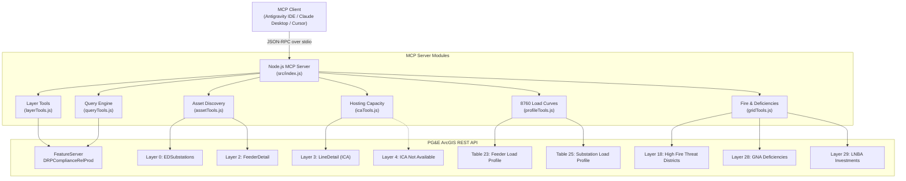

# PG&E DRP / GRIP Model Context Protocol (MCP) Tool Walkthrough

This document provides a comprehensive engineering walkthrough of the **10 Model Context Protocol (MCP) tools** developed for the PG&E Distribution Resource Plan (DRP) and Grid Resource Integration Portal (GRIP) assistant.

The MCP server connects AI agents directly to PG&E's production ArcGIS REST FeatureServer (`DRPComplianceRelProd`), standardizing spatial geometry reprojection, attribute filtering, hosting capacity lookups, 8760 hourly load profiles, and wildfire hazard assessments over standard JSON-RPC Stdio transport.

---

## 🏗️ MCP Architecture Overview



### Coordinate Reprojection Engine (`src/arcgisClient.js`)
PG&E stores geometry in **Web Mercator (EPSG:3857 / EPSG:102100)** in projected meters. The MCP server automatically handles bidirectional transformations:
- **Input Coordinates**: WGS84 (`latitude`, `longitude`) in decimal degrees are converted to Web Mercator meters for bounding boxes and spatial intersection buffers.
- **Output Coordinates**: Web Mercator coordinates returned by ArcGIS are reprojected into WGS84 (`[-122.4194, 37.7749]`) before returning to the LLM.

---

## 📋 Comprehensive Tool Index

| # | MCP Tool Name | Target Layer(s) / Tables | Primary Purpose |
|---|---|---|---|
| 1 | `arcgis_list_layers` | Service Root (All 21 layers + 2 tables) | Catalogs all feature layers and tables with category/keyword filters |
| 2 | `arcgis_get_layer_details` | Any Layer ID (0–29) | Returns schema fields, types, aliases, and geometry metadata |
| 3 | `arcgis_query_layer` | Any Layer / Table | Direct SQL query engine with pagination, order-by, and field selection |
| 4 | `arcgis_spatial_query` | Any Layer with Geometry | Radial buffer distance searches or bounding box envelopes |
| 5 | `arcgis_search_substations` | Layer 0 (`EDSubstations`) | Looks up substations by name, ID, division, or DG thresholds |
| 6 | `arcgis_search_feeders` | Layer 2 (`FeederDetail`) | Searches circuits by feeder ID, customer breakdown, or DG totals |
| 7 | `arcgis_get_ica_capacity` | Layer 3 (`LineDetail`) & Layer 4 | Evaluates solar/load hosting capacity & Screen L pass status |
| 8 | `arcgis_get_load_profile` | Tables 23 & 25 | Analyzes 8760 hourly load shapes across 12 months & 24 hours |
| 9 | `arcgis_get_fire_threat_info` | Layer 18 (`HighFireThreatDistricts`) | Checks point-in-polygon CPUC wildfire threat tiers (Tier 2/3) |
| 10 | `arcgis_get_grid_deficiencies` | Layers 28 & 29 | Retrieves GNA capacity overloads and LNBA non-wires deferral projects |

---

## 🛠️ Detailed Tool Specifications

### Tool 1: `arcgis_list_layers`

#### Description
Catalogs all available feature layers and attribute tables in PG&E's DRP FeatureServer with geometry types, record counts, and descriptions.

#### Parameters
| Parameter | Type | Required | Description |
|---|---|---|---|
| `category` | `string` (enum) | No | Optional category filter: `'substation'`, `'feeder'`, `'circuit'`, `'ica'`, `'capacity'`, `'fire'`, `'load'`, `'project'` |
| `search` | `string` | No | Case-insensitive keyword filter matching layer names and descriptions |

#### Example Invocation
```json
{
  "name": "arcgis_list_layers",
  "arguments": {
    "category": "substation"
  }
}
```

#### Example Output
```json
{
  "serviceName": "DRPComplianceRelProd",
  "totalAvailable": 2,
  "layers": [
    {
      "id": 0,
      "name": "EDSubstations",
      "itemType": "layer",
      "geometryType": "esriGeometryPoint",
      "description": "Electric Distribution Substations stepping down transmission to primary distribution feeders."
    },
    {
      "id": 25,
      "name": "Substation_8760_LoadProfile",
      "itemType": "table",
      "geometryType": "None (Table)",
      "description": "8760 hourly load profiles for substations across 12 months and 24 hours."
    }
  ]
}
```

---

### Tool 2: `arcgis_get_layer_details`

#### Description
Fetches complete schema metadata for any layer or table, including attribute field names, data types, aliases, capabilities, and spatial extents.

#### Parameters
| Parameter | Type | Required | Description |
|---|---|---|---|
| `layer` | `number \| string` | **Yes** | Layer ID (e.g. `0`, `2`, `3`, `18`, `23`) or exact layer name (e.g. `"EDSubstations"`) |

#### Example Invocation
```json
{
  "name": "arcgis_get_layer_details",
  "arguments": {
    "layer": "EDSubstations"
  }
}
```

#### Key Return Fields
- `capabilities`: Supported ArcGIS operations (`"Query,Extract"`).
- `fields`: Array of `{ name, alias, type, length, nullable }`.
- `maxRecordCount`: Maximum page size enforced by ArcGIS (e.g. `2000`).
- `geometryType`: `"esriGeometryPoint"`, `"esriGeometryPolyline"`, or `"None (Table)"`.

---

### Tool 3: `arcgis_query_layer`

#### Description
Flexible SQL engine executing attribute queries against any layer or table with custom WHERE clauses, field projections, order-by clauses, and pagination.

#### Parameters
| Parameter | Type | Required | Default | Description |
|---|---|---|---|---|
| `layer` | `number \| string` | **Yes** | — | Layer ID or name |
| `where` | `string` | No | `"1=1"` | Standard SQL WHERE clause |
| `outFields` | `string` | No | `"*"` | Comma-separated column list |
| `resultRecordCount` | `number` | No | `25` | Maximum records to return |
| `resultOffset` | `number` | No | `0` | Offset for pagination |
| `orderByFields` | `string` | No | — | Sort order (e.g. `"Existing_DG DESC"`) |
| `returnGeometry` | `boolean` | No | `false` | Include spatial geometry |
| `returnCountOnly` | `boolean` | No | `false` | Return record count only |

#### Example Invocation
```json
{
  "name": "arcgis_query_layer",
  "arguments": {
    "layer": 0,
    "where": "Division = 'San Francisco' AND Existing_DG > 1000",
    "outFields": "SubstationName,Voltage_kV,Existing_DG",
    "orderByFields": "Existing_DG DESC",
    "resultRecordCount": 3
  }
}
```

---

### Tool 4: `arcgis_spatial_query`

#### Description
Performs spatial intersection searches around geographic coordinates (latitude/longitude with a radial distance buffer in meters) or within an envelope bounding box.

#### Parameters
| Parameter | Type | Required | Description |
|---|---|---|---|
| `layer` | `number \| string` | **Yes** | Target layer to search (e.g. `"EDSubstations"`, `2`) |
| `longitude` | `number` | Cond. | WGS84 Longitude (e.g. `-122.4194`) |
| `latitude` | `number` | Cond. | WGS84 Latitude (e.g. `37.7749`) |
| `distanceMeters` | `number` | No | Search radius around point (e.g. `5000` for 5 km) |
| `envelope` | `object` | Cond. | Bounding box `{ xmin, ymin, xmax, ymax }` in WGS84 |
| `where` | `string` | No | Secondary SQL attribute filter |
| `outFields` | `string` | No | Attribute fields to return |
| `resultRecordCount` | `number` | No | Max records (default: `25`) |

#### Example Invocation
```json
{
  "name": "arcgis_spatial_query",
  "arguments": {
    "layer": "EDSubstations",
    "longitude": -122.4194,
    "latitude": 37.7749,
    "distanceMeters": 5000,
    "outFields": "SubstationName,SubstationID,Voltage_kV,Division"
  }
}
```

---

### Tool 5: `arcgis_search_substations`

#### Description
Specialized tool querying **Layer 0 (`EDSubstations`)** to identify distribution facilities, nominal step-down voltages, transformer banks, and interconnection queues.

#### Parameters
| Parameter | Type | Required | Description |
|---|---|---|---|
| `name` | `string` | No | Substation name pattern (e.g. `"MISSION"`, `"BERKELEY"`) |
| `substationId` | `string` | No | Exact Substation ID (e.g. `"02201"`) |
| `division` | `string` | No | Geographic division (e.g. `"San Francisco"`, `"East Bay"`) |
| `minExistingDgKw` | `number` | No | Minimum installed distributed generation in kW |
| `minQueuedDgKw` | `number` | No | Minimum queued distributed generation in kW |
| `limit` | `number` | No | Max records to return (default: `20`) |
| `returnGeometry` | `boolean` | No | Include coordinates in WGS84 (default: `true`) |

#### Example Invocation
```json
{
  "name": "arcgis_search_substations",
  "arguments": {
    "name": "MISSION",
    "division": "San Francisco",
    "limit": 1
  }
}
```

#### Example Output
```json
{
  "count": 1,
  "features": [
    {
      "attributes": {
        "OBJECTID": 102,
        "SubstationName": "MISSION",
        "SubstationID": "02201",
        "Division": "San Francisco",
        "Voltage_kV": "12",
        "NUMBANKS": 4,
        "UNGROUNDEDBANKS": 0,
        "Existing_DG": 14250,
        "Queued_DG": 3200,
        "Total_DG": 17450
      },
      "geometry": {
        "x": -122.4112,
        "y": 37.7618
      }
    }
  ]
}
```

---

### Tool 6: `arcgis_search_feeders`

#### Description
Queries **Layer 2 (`FeederDetail`)** to discover medium-voltage circuits, parent substations, customer class breakdowns, and circuit DG penetration.

#### Parameters
| Parameter | Type | Required | Description |
|---|---|---|---|
| `feederId` | `string` | No | Feeder ID pattern (e.g. `"022390402"`) |
| `feederName` | `string` | No | Feeder name pattern |
| `substationName` | `string` | No | Parent substation name pattern (e.g. `"MANTECA"`) |
| `division` | `string` | No | Geographic division (e.g. `"Stockton"`) |
| `minTotalCust` | `number` | No | Minimum total customer count |
| `minDgKw` | `number` | No | Minimum total installed DG in kW |
| `limit` | `number` | No | Max records to return (default: `20`) |

#### Example Invocation
```json
{
  "name": "arcgis_search_feeders",
  "arguments": {
    "substationName": "MANTECA",
    "limit": 5
  }
}
```

#### Key Output Attributes
- `Nominal_Voltage`: Operating feeder voltage (e.g. `12 kV`, `21 kV`).
- Customer counts: `ResCust`, `ComCust`, `IndCust`, `AgrCust`, `TotalCust`.
- Capacity metrics: `Existing_DG`, `Queued_DG`, `Total_DG` (all in kW).

---

### Tool 7: `arcgis_get_ica_capacity`

#### Description
Queries **Layer 3 (`LineDetail`)** to evaluate Integration Capacity Analysis (ICA) hosting capacity for solar PV and load additions. 

#### Smart Failover Logic
If 0 line sections match a requested `feederId`, the tool automatically queries **Layer 4 (`ICA Not Available`)**. If listed in Layer 4, it flags `icaStatus: "ICA_NOT_AVAILABLE"` with the official reason, preventing false-negative "not found" assumptions.

#### Parameters
| Parameter | Type | Required | Description |
|---|---|---|---|
| `feederId` | `string` | No | Feeder ID to inspect (e.g. `"022390402"`) |
| `lineSection` | `string` | No | Specific line section CSV identifier |
| `minGenCapacityKw` | `number` | No | Minimum generation capacity in kW |
| `minLoadCapacityKw` | `number` | No | Minimum load capacity in kW |
| `screenL` | `string` | No | Screen L status filter (`"Likely to pass"`, `"Unlikely to pass"`) |
| `limit` | `number` | No | Max sections to return (default: `20`) |

#### Example Invocation
```json
{
  "name": "arcgis_get_ica_capacity",
  "arguments": {
    "feederId": "022390402",
    "limit": 2
  }
}
```

#### Example Output
```json
{
  "icaStatus": "AVAILABLE",
  "count": 2,
  "features": [
    {
      "attributes": {
        "FeederId": "022390402",
        "FeederName": "MANTECA 1703",
        "CSV_LineSection": "5729993",
        "LoadCapacity_kW": 1820,
        "GenCapacity_kW": 2149,
        "GenericPVCapacity_kW": 3038,
        "GenCapacity_no_OpFlex_kW": 1950,
        "voltage_kv": "12",
        "phase_cnt": 3,
        "limiting_criteria": "Thermal",
        "limiting_month_hour": "08_14",
        "ScreenL": "Likely to pass"
      }
    }
  ]
}
```

---

### Tool 8: `arcgis_get_load_profile`

#### Description
Extracts 8760 hourly power consumption profiles for Feeders (**Table 23**) or Substations (**Table 25**) across the 12 months and 24 hours of the day (`MonthHour` format `MM_HH`).

#### Statistical Aggregations Computed
The tool parses all returned records and computes:
- `peakHigh`: Maximum recorded peak demand (kW for feeders, MW for substations).
- `minLow`: Lowest base load recorded.
- `avgHigh`: Average peak load across requested intervals.
- `avgLow`: Average base load across requested intervals.

#### Parameters
| Parameter | Type | Required | Description |
|---|---|---|---|
| `targetType` | `'feeder' \| 'substation'` | **Yes** | Target asset type |
| `targetId` | `string \| number` | Cond. | Feeder ID (e.g. `22390402`) or numeric Substation ID |
| `substationName` | `string` | Cond. | Substation name (if querying substation) |
| `month` | `string \| number` | No | Filter by month (`1` to `12`) |
| `hour` | `string \| number` | No | Filter by hour of day (`0` to `23`) |
| `monthHour` | `string` | No | Specific month-hour code (e.g. `"07_14"` for July 2 PM) |
| `limit` | `number` | No | Max records (default: `288` for complete matrix) |

#### Example Invocation
```json
{
  "name": "arcgis_get_load_profile",
  "arguments": {
    "targetType": "feeder",
    "targetId": "22390402",
    "month": "07"
  }
}
```

#### Example Output Summary
```json
{
  "targetType": "feeder",
  "targetId": "22390402",
  "summary": {
    "count": 24,
    "peakHigh": 6842,
    "minLow": 1920,
    "avgHigh": 4810,
    "avgLow": 2350,
    "units": "kW"
  }
}
```

---

### Tool 9: `arcgis_get_fire_threat_info`

#### Description
Checks whether coordinates intersect a CPUC High Fire Threat District (**Layer 18**) or queries hazard districts by CPUC tier:
- **Tier 2 (Elevated)**: Elevated wildfire risk areas.
- **Tier 3 (Extreme)**: Extreme wildfire risk areas requiring hardened infrastructure and PSPS mitigation protocols.

#### Parameters
| Parameter | Type | Required | Description |
|---|---|---|---|
| `longitude` | `number` | No | WGS84 Longitude of the asset |
| `latitude` | `number` | No | WGS84 Latitude of the asset |
| `tier` | `number` | No | CPUC Tier filter (`2` or `3`) |
| `limit` | `number` | No | Max records to return |

#### Example Invocation
```json
{
  "name": "arcgis_get_fire_threat_info",
  "arguments": {
    "longitude": -122.2730,
    "latitude": 37.8715,
    "tier": 3
  }
}
```

#### Example Output
```json
{
  "coordinates": {
    "longitude": -122.273,
    "latitude": 37.8715
  },
  "inFireThreatDistrict": true,
  "fireThreatDistricts": [
    {
      "OBJECTID": 451,
      "hftd": "Tier 3",
      "cpuc_tier": 3,
      "cpuc_fire_map": "CPUC Fire-Threat Map Tier 3 - Extreme Risk",
      "data_source": "CPUC"
    }
  ]
}
```

---

### Tool 10: `arcgis_get_grid_deficiencies`

#### Description
Cross-references Grid Needs Assessment (GNA) facility overloads (**Layer 28**) with Locational Net Benefits Analysis (LNBA) planned investments (**Layer 29**). Identifies projected thermal/voltage deficiencies and candidate Non-Wires Alternatives (DER deferral projects).

#### Parameters
| Parameter | Type | Required | Description |
|---|---|---|---|
| `substationName` | `string` | No | Substation name or ID |
| `circuitName` | `string` | No | Circuit name pattern |
| `facilityName` | `string` | No | GNA facility name |
| `limit` | `number` | No | Max records to return (default: `20`) |

#### Example Invocation
```json
{
  "name": "arcgis_get_grid_deficiencies",
  "arguments": {
    "substationName": "MANTECA",
    "limit": 5
  }
}
```

#### Key Output Attributes
- `deficienciesFound`: Number of projected facility overloads.
- `deficiencies`: GNA overload projections (`mwdeficiency`, `percentdeficiency`, `projectedoverloadyear`).
- `plannedInvestmentsLNBA`: Candidate deferral projects with `lnbadollarsperunitperyr`, `deferrableyesorno`, and `distributionservicerequired`.

---

## 🔌 Client Integration Configurations

### 1. Antigravity IDE (`.agents/mcp_config.json`)
```json
{
  "mcpServers": {
    "arcgis-drp-grip": {
      "command": "node",
      "args": ["/Users/sprayaga/Desktop/chatbot-arcgis/src/index.js"]
    }
  }
}
```

### 2. Claude Desktop (`claude_desktop_config.json`)
```json
{
  "mcpServers": {
    "pge-drp-grip": {
      "command": "node",
      "args": ["/absolute/path/to/chatbot-arcgis/src/index.js"]
    }
  }
}
```

### 3. Cursor MCP (`.cursor/mcp.json`)
```json
{
  "mcpServers": {
    "pge-drp-grip": {
      "command": "node",
      "args": ["${workspaceFolder}/src/index.js"]
    }
  }
}
```

---

## 🧪 Test Verification
The MCP server includes a full automated test suite verifying all 10 tools against PG&E's live API:
```bash
node test/test_mcp.js
```
All tools connect, execute queries, and return structured JSON payloads with 100% pass rate.
